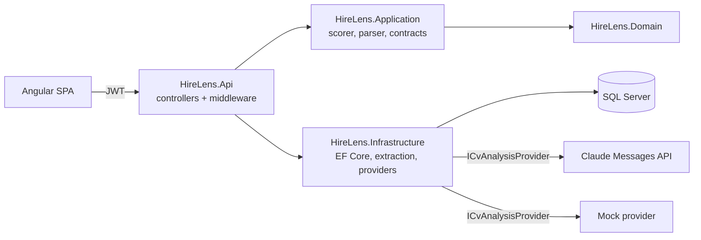

# HireLens

**See the fit before the interview.** HireLens is an AI-assisted CV-vs-job-description matcher for HR teams. Upload a JD and up to 10 CVs and get, per CV, an **ATS score**, a **CV quality score**, a **fit verdict** and the **gaps to improve**, with the ATS computation fully explained.

Angular · ASP.NET Core · EF Core · SQL Server · Claude (Anthropic)

> Screenshots: _placeholder - add `docs/screenshots/login.png`, `results.png`, `history.png`_

## Features
- Login (JWT) with `Admin` and `HR` roles; HR users only see their own analyses.
- New analysis: paste/upload a JD, upload 1-10 CVs (PDF/DOCX/TXT, 5 MB each), per-CV progress.
- Results: animated score rings, verdict badge, matched/missing skill chips, gaps table with suggestions, ranking, and an explainable ATS breakdown.
- History with search by role title and date range, pagination, detail view, delete.
- Export a result as PDF (QuestPDF) or print.
- Admin: manage users, usage stats (analyses, tokens, cache hit rate), default model, CV file auto-delete (N days).
- Dark mode, SVG logo and favicon.

## Architecture


Middleware (hand-written): correlation ID, global exception handling to ProblemDetails, request timing, and rate limiting on the CV analysis endpoint.

## Run it
Prerequisites: .NET SDK (see `global.json`), Node + npm, SQL Server LocalDB.

```bash
# 1. secrets (one time)
cd src/HireLens.Api
dotnet user-secrets set "Jwt:Key" "<random 32+ char string>"
dotnet user-secrets set "Seed:AdminPassword" "<10+ chars, mixed>"   # admin@hirelens.local
dotnet user-secrets set "Anthropic:ApiKey" "<your key>"             # optional, enables real AI scoring

# 2. API (http://localhost:5110, Swagger at /swagger). Migrations apply on startup.
dotnet run --launch-profile http

# 3. UI (http://localhost:4200)
cd ../../web && npm install && npx ng serve
```

Without an Anthropic key the app uses the deterministic **mock provider**. To use Sonnet for deeper analysis, set `Anthropic:Model` to `claude-sonnet-5-5` or change the default model on the Admin page.

Tests: `dotnet test` (unit + API integration, in-memory DB) and `cd web && npx ng build`.

## Cost and token approach
1. Text is extracted **locally** (PdfPig, OpenXML, TXT), whitespace-normalised, boilerplate stripped and length-capped.
2. The **ATS score is computed deterministically in C#** (60 pts keyword coverage, 15 sections, 10 contact, 5 dates, 10 format). The LLM only judges what keywords cannot.
3. **One LLM call per CV**, compact system prompt, `max_tokens` 1200, default model `claude-haiku-5-5`.
4. Strict JSON output, validated; one retry with "return valid JSON only" on malformed output.
5. Results are **cached** in SQL by SHA-256 of (JD + CV + model), so re-running the same pair costs nothing.
6. Token usage is logged per analysis; **CV contents are never logged**.

## Privacy
Uploaded CV files are removed automatically after N days (admin setting, default 30; 0 = keep) by a background service. Scores remain. Only synthetic CVs live in `samples/`.

## Layout
`src/` API + layers · `tests/` xUnit · `web/` Angular · `samples/` synthetic JD/CVs · `docs/` decisions and open questions.
